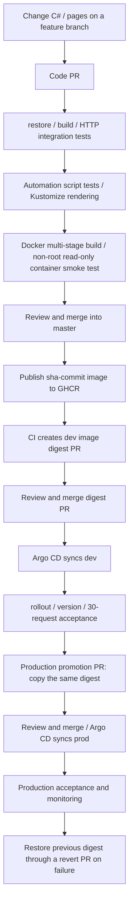

# Complete .NET CI/CD runbook

The application has migrated to ASP.NET Core / .NET 10. Browser assets remain HTML/CSS/JavaScript; C# implements the HTTP server and reverse proxy. Node.js runs only repository automation scripts and is not included in the application image. The database remains an optional platform extension example; the application has no SQL functionality.

## Delivery flow



This is the repository's complete delivery path for kind + GitOps. Initial AKS Terraform creation and application deployment follow the separate path below; that path is not connected to a real Azure automatic-deployment service connection.

## 1. Files and responsibilities

| File | Responsibility |
| --- | --- |
| `global.json` | Pins SDK 10.0.402 and allows patch updates within the same feature band |
| `app/PodFlow.csproj`, `app/Program.cs` | .NET web application, proxy, health and metrics endpoints |
| `app/wwwroot/` | Existing pages and assets exposed through an explicit allowlist |
| `test/PodFlow.SmokeTests.csproj` | Executable C# HTTP integration test runner without external test packages |
| `test/UnitTests/PodFlow.UnitTests.csproj` | xUnit unit tests; NuGet dependencies reused through the CI cache |
| `Dockerfile` | SDK build/publish → ASP.NET runtime, UID/GID 1000, port 8080 |
| `.github/workflows/ci.yaml` | PR validation, image build tests, master publication, digest PR |
| `scripts/update-image.js` | Updates the image name and digest in the dev overlay |
| `scripts/promote-production.ps1` | Copies the dev image identity into the prod overlay |
| `scripts/verify-release.ps1` | Rollout, Argo, version, and HTTP acceptance using an explicit context |
| `argocd/application.yaml`, `argocd/prod/application.yaml` | Automatically sync dev/prod overlays |
| `azure-pipelines.cd.yml` | Retained Azure DevOps CD **simulation**, producing review artifacts only |
| `azure-pipelines.terraform.yml` | Static Terraform validation without creating Azure resources |

Application endpoints remain `/`, `/style.css`, `/client.js`, `/api/whoami`, `/healthz`, `/readyz`, and `/metrics`. Setting `UPSTREAM_URL=http://demo` turns the same image into a web proxy; without it, the image runs as a backend. Each forwarded request uses a separate upstream connection to avoid connection reuse repeatedly targeting the same Pod.

## 2. Local development and testing

Install .NET SDK 10.0.402, Node 24, and Git. Container and cluster validation also require Docker Desktop, kubectl, and kind. All commands use standard installations on PATH rather than a temporary project-local tools directory. When building and deploying only through Docker, the host does not need the .NET SDK because the Dockerfile provides it. See [native local Kubernetes commands](local-k8s.md) for local deployment steps.

```powershell
git switch -c codex/migrate-dotnet
dotnet --version
dotnet restore test/UnitTests/PodFlow.UnitTests.csproj --configfile NuGet.Config --locked-mode
dotnet test test/UnitTests/PodFlow.UnitTests.csproj --no-restore
dotnet restore test/PodFlow.SmokeTests.csproj --configfile NuGet.Config
dotnet build test/PodFlow.SmokeTests.csproj -c Release --no-restore
dotnet run --project test/PodFlow.SmokeTests.csproj -c Release --no-build
npm test
npm run validate
node --check app/wwwroot/client.js
dotnet run --project app/PodFlow.csproj --urls http://localhost:8080
```

Open http://localhost:8080. A standalone instance has one local backend identity; demonstrating traffic distribution across three Pods requires Kubernetes. The test runner uses real Kestrel instances on random ports to verify pages, static assets, route isolation, probes, metrics, security headers, proxy behavior, separate upstream connections, and unavailable/invalid/oversized responses. It is an integration test executable run with `dotnet run`; `dotnet test` is not a substitute.

```powershell
docker build --build-arg VERSION=local-dotnet -t podflow:local .
docker run --rm --read-only --cap-drop ALL --security-opt no-new-privileges --user 1000:1000 -p 8080:8080 podflow:local
```

## 3. Configure GitHub and Argo CD (once)

- Confirm the remote repository, `master` branch, and Argo CD repoURL agree. For forks, update both the Argo repoURL and image repository name.
- Enable GitHub Actions and allow the workflow to write Packages. The publish job uses GITHUB_TOKEN to push to GHCR.
- Make the GHCR package public so the existing cluster does not need a pull secret. Private packages require imagePullSecrets; never store credentials in Git.
- Automatic release PR creation requires `GITOPS_PR_TOKEN`. Use a restricted token with Contents/Pull requests write access to the target repository, managed under organization policy. Without this secret, CI only pushes a review branch and a maintainer creates the PR manually.
- Protect `master` and require PR reviews and CI's `test` job before merging. A PAT/GitHub App can trigger checks on release PRs; events created with the default GITHUB_TOKEN generally do not trigger subsequent workflows.
- Follow the root README to create the kind development cluster and run `scripts/bootstrap.ps1`. Follow `docs/production.md` to create the separate production rehearsal cluster. Private repositories also need Argo repository credentials.

Do not update an overlay to a .NET digest that does not exist. Existing dev/prod digests still refer to historical Node images; publish the first .NET image before updating them through a release PR.

## 4. Code PR and CI

```powershell
git add app test k8s/base Dockerfile .dockerignore global.json NuGet.Config package.json .github scripts README.md docs .gitignore
git commit -m "Migrate application and CI to ASP.NET Core"
git push -u origin HEAD
gh pr create --base master --title "Migrate application to .NET" --body "Replace the HTTP server with ASP.NET Core and validate the existing application contract and container deployment."
```

These are example commands; the migration changes did not perform a commit, push, or PR creation. Inspect `git diff --cached` before committing and preserve other uncommitted Terraform work.

PR validation automatically runs SDK restore/build, C# integration tests, Node image-update tests, configuration checks, rendering of both overlays, and a real Linux image build. Container tests use a read-only filesystem, UID 1000, and dropped capabilities, and check probes, pages, and APP_VERSION. PRs do not push images or access an existing cluster.

`scripts/verify-container.sh` maps the test container's port 8080 to `127.0.0.1:18081` on the GitHub runner; it does not access the developer's computer or Kubernetes Pods. Readiness checks retry connection resets, refused connections, and HTTP errors during startup, and check for early container exit. Each request has a timeout, with at most 30 attempts; page and version checks run only after readiness succeeds. On exit, the script prints container status and logs and cleans up the test container. `--noproxy '*'` keeps local traffic out of HTTP proxies.

CI also runs xUnit unit tests and uploads TRX results, reusing cached NuGet packages when dependency lockfiles are unchanged. See [NuGet caching](nuget-cache.md).

## 5. Release to development

After the code PR is merged, CI tests again and pushes `ghcr.io/<owner>/<repo>:sha-<commit>`. Deployment uses the returned `sha256:...`, not a mutable tag. The image sets `APP_VERSION=<source commit SHA>`.

CI updates `k8s/overlays/dev/kustomization.yaml` and creates a `gitops/image-<sha>` PR. Without a PR token, create the PR manually from that branch. Review the image source and digest, then merge; Argo CD syncs automatically. The image PR does not change application source, and push path filters prevent another image publication for that change. Its PR checks still run.

```powershell
kubectl --context kind-cicd-gitops -n argocd get application cicd-demo
kubectl --context kind-cicd-gitops -n cicd-demo get pods -o wide
kubectl --context kind-cicd-gitops -n cicd-demo port-forward svc/demo-web 8081:80
```

Keep the port forward running and execute the following in another terminal. Set `ExpectedVersion` to the image's 40-character source commit SHA, not the digest PR's SHA:

```powershell
./scripts/verify-release.ps1 -Context kind-cicd-gitops -Namespace cicd-demo -ArgoApplication cicd-demo -ExpectedVersion '<source-commit-sha>'
```

Acceptance requires a successful rollout, Argo Synced/Healthy, and all 30 requests returning the target version. Pod distribution is printed; random requests do not guarantee an even distribution.

## 6. Production promotion

First confirm dev is deployed and accepted, then create a promotion branch from the latest master. Production reuses the same image and **does not rebuild it**:

```powershell
git switch master
git pull --ff-only
git switch -c codex/promote-dotnet-production
./scripts/promote-production.ps1
kubectl kustomize k8s/overlays/prod
git diff -- k8s/overlays/prod/kustomization.yaml
git add k8s/overlays/prod/kustomization.yaml
git commit -m "Promote validated .NET image to production"
git push -u origin HEAD
gh pr create --base master --title "Promote .NET release to production" --body "Promote the exact image digest accepted in development."
```

After review and merge, production Argo CD syncs the prod overlay, retaining the existing three backend replicas, two web replicas, Ingress, and PDBs. Verify using the actual source commit SHA:

```powershell
./scripts/verify-release.ps1 -Context kind-cicd-production -Namespace cicd-prod -BaseUrl http://localhost:18080 -ArgoApplication cicd-production -ExpectedVersion '<source-commit-sha>'
```

## 7. Rollback and maintenance

On a new branch, run `git revert <commit-that-changed-the-target-environment-digest>`, then review and merge the rollback PR. Argo CD automatically restores the previous image; verify it with the previous version's SHA. Do not substitute `kubectl rollout undo` for GitOps rollback, since self-healing overwrites it. Retain old GHCR images.

Continuously observe Ready replicas, restarts, error rates, latency, Prometheus metrics, and JSON container logs. Regularly update SDK/runtime images, security scans, and resource capacity. The SDK uses a specific version; the runtime currently uses the `10.0` servicing tag. For real production, review and pin the base-image digest and add image scanning, signing, and admission verification.

## 8. Azure AKS Terraform path

This path reuses the same .NET image, but Terraform currently manages the application. Argo CD must not manage the same resources simultaneously.

1. Follow `infra/azure/README.md` to configure the subscription and Entra IDs. Run platform init → plan → review → apply on a runner with VNet/private DNS access.
2. A platform administrator precreates the `cicd-azure` namespace. The application identity has only Writer access to that namespace and Cluster User permissions.
3. After GitHub CI publishes the .NET image and dev acceptance succeeds, set `image` in `infra/azure/application/terraform.tfvars` to its real GHCR digest and specify the AKS context.
4. On a private-network runner, execute application init → plan → review → apply. Port-forward using the AKS context and `cicd-azure` namespace, then run `verify-release.ps1` without ArgoApplication.
5. For later releases or rollbacks, repeat application plan/apply with the target digest and verify the corresponding source commit SHA. The two Terraform roots use separate, secure remote state.

Neither the existing `azure-pipelines.cd.yml` nor the added Terraform validation pipeline has real Azure deployment permissions. Automatic Azure DevOps apply also requires an OIDC service connection, protected-environment approvals, a remote backend, and a VNet-connected self-hosted agent. These missing integrations are not claimed to be live.

## 9. Migration verification boundaries

Migrating source code does not migrate the running application. The cluster runs .NET only after the new image is published, the target overlay/variables are updated, Argo/Terraform deploys it, and version acceptance completes. Historical Node cluster validation records do not prove that .NET is deployed.

See [the migration validation record](dotnet-validation.md) for local build, HTTP integration test, and publish validation results.

Official references: [.NET support policy](https://dotnet.microsoft.com/en-us/platform/support/policy), [.NET Docker](https://learn.microsoft.com/en-us/dotnet/core/docker/), [publishing images with GitHub Actions](https://docs.github.com/en/actions/tutorials/publish-packages/publish-docker-images).
