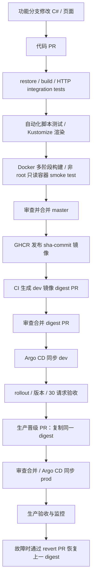

# .NET 完整 CI/CD 操作流程

应用已迁移为 ASP.NET Core / .NET 10。浏览器静态页面仍是 HTML/CSS/JavaScript；HTTP 服务和反向代理由 C# 实现。Node.js 只运行仓库自动化脚本，不进入应用镜像。数据库仍是可选的平台扩展示例，应用没有 SQL 功能。

## 交付链路



这是仓库已有 kind + GitOps 的完整交付路径。AKS Terraform 的首次创建及应用部署见后面的独立路径；它尚未接入真实 Azure 自动部署服务连接。

## 1. 文件与职责

| 文件 | 职责 |
| --- | --- |
| `global.json` | 固定 SDK 10.0.402，允许同 feature band 的补丁更新 |
| `app/PodFlow.csproj`、`app/Program.cs` | .NET Web 应用、代理、健康与指标接口 |
| `app/wwwroot/` | 原有页面与资源，显式白名单暴露 |
| `test/PodFlow.SmokeTests.csproj` | 无外部测试包的 C# HTTP 集成测试可执行程序 |
| `test/UnitTests/PodFlow.UnitTests.csproj` | xUnit 单元测试；NuGet 依赖通过 CI 缓存复用 |
| `Dockerfile` | SDK 编译发布 → ASP.NET runtime，UID/GID 1000，端口 8080 |
| `.github/workflows/ci.yaml` | PR 校验、镜像构建测试、master 发布、digest PR |
| `scripts/update-image.js` | 修改 dev overlay 的镜像名与 digest |
| `scripts/promote-production.ps1` | 将 dev 镜像身份复制到 prod overlay |
| `scripts/verify-release.ps1` | 显式 context 下的 rollout、Argo、版本与 HTTP 验收 |
| `argocd/application.yaml`、`argocd/prod/application.yaml` | 自动同步 dev/prod overlay |
| `azure-pipelines.cd.yml` | 保留的 Azure DevOps CD **模拟**，只输出审查制品 |
| `azure-pipelines.terraform.yml` | Terraform 静态校验，不创建 Azure 资源 |

应用接口保持 `/`、`/style.css`、`/client.js`、`/api/whoami`、`/healthz`、`/readyz`、`/metrics`。`UPSTREAM_URL=http://demo` 使相同镜像成为 Web 代理；不设置时作为后端。每次转发使用独立上游连接，避免连接复用固定命中同一 Pod。

## 2. 本地开发与测试

安装 .NET SDK 10.0.402、Node 24、Git；容器与集群验证还需要 Docker Desktop、kubectl、kind。仓库 `tools/dotnet/dotnet.exe` 是本次校验用的忽略文件，不会随 Git 分发；通常将已安装 SDK 的 `dotnet` 加入 PATH。

```powershell
git switch -c codex/migrate-dotnet
dotnet --version
dotnet restore test/UnitTests/PodFlow.UnitTests.csproj --configfile NuGet.Config --locked-mode
dotnet test test/UnitTests/PodFlow.UnitTests.csproj --no-restore
dotnet restore test/PodFlow.SmokeTests.csproj --configfile NuGet.Config
dotnet build test/PodFlow.SmokeTests.csproj -c Release --no-restore
dotnet run --project test/PodFlow.SmokeTests.csproj -c Release --no-build
npm test
npm run validate
node --check app/wwwroot/client.js
dotnet run --project app/PodFlow.csproj --urls http://localhost:8080
```

打开 http://localhost:8080。单独运行时只有一个本地后端身份；三个 Pod 的分布演示需要 Kubernetes。测试 runner 通过真实随机端口 Kestrel 验证页面、静态资源、路由隔离、探针、指标、安全响应头、代理、独立上游连接以及不可用/错误/超大响应。它是 `dotnet run` 执行的集成测试程序，不能用 `dotnet test` 替代。

```powershell
docker build --build-arg VERSION=local-dotnet -t podflow:local .
docker run --rm --read-only --cap-drop ALL --security-opt no-new-privileges --user 1000:1000 -p 8080:8080 podflow:local
```

## 3. 配置 GitHub 与 Argo CD（一次性）

- 确认远端仓库、`master` 分支及 Argo CD 的 repoURL 相符；fork 项目需同步修改 Argo repoURL 和镜像仓库名。
- 启用 GitHub Actions，允许工作流写入 Packages；发布 job 使用 GITHUB_TOKEN 推送 GHCR。
- 将 GHCR package 设置为公开，使现有集群无需拉取 secret。私有包需额外配置 imagePullSecrets，不能把凭据放入 Git。
- 自动创建 release PR 需要 `GITOPS_PR_TOKEN`，使用对目标仓库 Contents/Pull requests 写权限的受限 token，并按组织策略管理。没有该 secret 时，CI 只推送 review branch，由维护者手工创建 PR。
- 保护 `master`，要求 PR 审查和 CI 的 `test` job，通过后才允许合并。使用 PAT/GitHub App 创建 release PR 可触发 PR 检查；默认 GITHUB_TOKEN 创建事件通常不会触发后续工作流。
- 按根 README 创建 kind 开发集群并运行 `scripts/bootstrap.ps1`；按 `docs/production.md` 创建独立生产演练集群。私有仓库还需配置 Argo 仓库凭据。

不要先把 overlay 改成不存在的 .NET digest。现有 dev/prod digest 仍对应历史 Node 镜像，必须先完成首次 .NET 镜像发布，再通过 release PR 更新。

## 4. 代码 PR 与 CI

```powershell
git add app test k8s/base Dockerfile .dockerignore global.json NuGet.Config package.json .github scripts README.md docs .gitignore
git commit -m "Migrate application and CI to ASP.NET Core"
git push -u origin HEAD
gh pr create --base master --title "Migrate application to .NET" --body "Replace the HTTP server with ASP.NET Core and validate the existing application contract and container deployment."
```

以上为操作示例，本次修改没有执行 commit/push/PR。提交前检查 `git diff --cached`，保留其他尚未提交的 Terraform 工作。

PR 自动执行 SDK restore/build、C# 集成测试、Node 镜像更新测试、配置检查、两个 overlay 渲染，并构建真实 Linux 镜像。容器测试使用只读文件系统、UID 1000、删除 capabilities，并检查探针、页面和 APP_VERSION。PR 不推镜像、不访问集群。

CI 还运行 xUnit 单元测试并上传 TRX 结果；依赖锁文件不变时复用 NuGet 包缓存。详见 [NuGet 缓存说明](nuget-cache.md)。

## 5. 发布开发版本

代码 PR 合并后，CI 再次测试并推送 `ghcr.io/<owner>/<repo>:sha-<commit>`。部署使用返回的 `sha256:...`，不使用可变 tag。镜像设置 `APP_VERSION=<source commit SHA>`。

CI 更新 `k8s/overlays/dev/kustomization.yaml`，创建 `gitops/image-<sha>` PR；没有 PR token 时，从该分支手工创建 PR。审查镜像来源与 digest、合并后，Argo CD 自动同步。镜像 PR 不改应用源码，push 路径过滤避免因此再发布一次镜像；其 PR 检查仍会运行。

```powershell
kubectl --context kind-cicd-gitops -n argocd get application cicd-demo
kubectl --context kind-cicd-gitops -n cicd-demo get pods -o wide
kubectl --context kind-cicd-gitops -n cicd-demo port-forward svc/demo-web 8081:80
```

保留 port-forward，在另一个终端执行，`ExpectedVersion` 填本次镜像的源代码 40 位 SHA，而非 digest PR 的 SHA：

```powershell
./scripts/verify-release.ps1 -Context kind-cicd-gitops -Namespace cicd-demo -ArgoApplication cicd-demo -ExpectedVersion '<source-commit-sha>'
```

验收要求 rollout 成功、Argo Synced/Healthy、30 次请求均返回目标版本。输出 Pod 分布；随机请求不保证平均分布。

## 6. 生产晋级

先确认 dev 已部署并验收，再基于最新 master 创建晋级分支。生产复用同一镜像，**不重新构建**：

```powershell
git switch master
git pull --ff-only
git switch -c codex/promote-dotnet-production
./scripts/promote-production.ps1
kubectl kustomize k8s/overlays/prod
git diff -- k8s/overlays/prod/kustomization.yaml
git add k8s/overlays/prod/kustomization.yaml
git commit -m "Promote validated .NET image to production"
git push -u origin HEAD
gh pr create --base master --title "Promote .NET release to production" --body "Promote the exact image digest accepted in development."
```

审查并合并后，生产 Argo CD 同步 prod overlay，保留现有 3 个后端、2 个 Web 副本、Ingress 与 PDB。用真实源代码 SHA 验收：

```powershell
./scripts/verify-release.ps1 -Context kind-cicd-production -Namespace cicd-prod -BaseUrl http://localhost:18080 -ArgoApplication cicd-production -ExpectedVersion '<source-commit-sha>'
```

## 7. 回滚与维护

在新分支 `git revert <修改目标环境 digest 的提交>`，审查并合并 rollback PR，Argo CD 自动恢复旧镜像；再用旧版本 SHA 验收。不要以 `kubectl rollout undo` 代替 GitOps 回滚，自愈会重新覆盖它。旧 GHCR 镜像必须保留。

持续观察 Ready 副本、重启、错误率、延迟、Prometheus 指标和 JSON 容器日志。定期更新 SDK/runtime 镜像、安全扫描与资源容量。SDK 使用具体版本，runtime 目前使用 `10.0` 维护 tag；正式生产应审查并固定 base-image digest，以及增加镜像扫描、签名和准入验证。

## 8. Azure AKS Terraform 路径

这条路径复用相同 .NET 镜像，但目前应用由 Terraform 管理，不能让 Argo CD 同时管理同一批资源。

1. 按 `infra/azure/README.md` 填写订阅、Entra IDs；在能访问 VNet/私有 DNS 的 runner 上执行 platform init → plan → 审查 → apply。
2. 平台管理员预创建 `cicd-azure` 命名空间。应用身份只有该 namespace 的 Writer 和 Cluster User 权限。
3. GitHub CI 发布 .NET 镜像并完成 dev 验收后，将其真实 GHCR digest 写入 `infra/azure/application/terraform.tfvars` 的 `image`，指定 AKS context。
4. 在私网 runner 上执行 application init → plan → 审查 → apply；使用 AKS context、`cicd-azure` namespace port-forward 后运行 `verify-release.ps1`，不传 ArgoApplication。
5. 后续发布或回滚使用目标 digest 重复 application plan/apply，并验证对应源代码 SHA。两个 Terraform root 使用独立、安全的远程状态。

原有 `azure-pipelines.cd.yml` 和新增 Terraform 校验流水线都没有真实 Azure 部署权限。若需要 Azure DevOps 自动 apply，还必须配置 OIDC service connection、受保护环境审批、远程 backend 与 VNet 自托管 agent；本次未把这些缺失条件描述为已上线。

## 9. 本次验证边界

源代码迁移不等于线上应用已迁移。只有新镜像发布、目标 overlay/变量更新、Argo/Terraform 部署及版本验收完成后，集群才运行 .NET。仓库历史 Node 集群验证记录不用于证明 .NET 已部署。

本机编译、HTTP 集成测试与发布验证结果见 [本次验证记录](dotnet-validation.md)。

官方参考：[.NET 支持策略](https://dotnet.microsoft.com/en-us/platform/support/policy)、[.NET Docker](https://learn.microsoft.com/en-us/dotnet/core/docker/)、[GitHub Actions 发布镜像](https://docs.github.com/en/actions/tutorials/publish-packages/publish-docker-images)。
